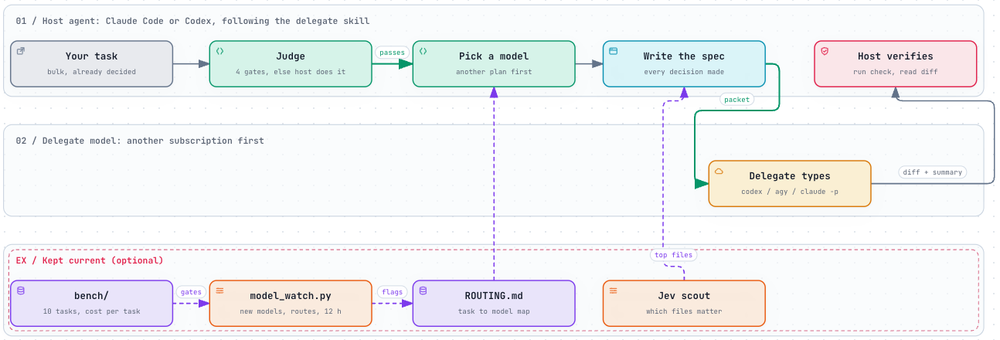

<picture>
  <source media="(prefers-color-scheme: dark)" srcset="docs/workflow-dark.png">
  
</picture>

# delegate-router: multi-model task delegation for Claude Code and Codex CLI

**One agent thinks, another types.** delegate-router is an agent skill (SKILL.md, the Agent
Skills format) for **Claude Code** and **OpenAI Codex CLI** that works as an LLM router for
coding work. It hands bulky, already-decided work (boilerplate, scaffolding, test stubs,
mechanical edits across many files, reading media and long documents) to another model you
already pay for: **Codex** (GPT models), **Gemini** through the Antigravity `agy` CLI, or a
**Claude Opus** subagent. The host keeps the design and the verification, and saves its own
quota and context.

- **Routing by task, not by habit.** [ROUTING.md](skills/delegate/ROUTING.md) maps each kind of
  task to an ordered list of models, chosen from independent benchmarks and cost per task.
  It skips any CLI you don't have, never routes back to the host's own model (except an
  Opus subagent under an Opus host, which keeps the main context clean), and prefers a model
  on another of your subscriptions, so the work spreads across the plans you pay for.
- **A judge before every handoff.** Four gates (bulk, decided, verifiable, contained) and a
  never-delegate list (debugging, architecture, security code, anything under ~40 lines).
- **The host always verifies.** A delegate's "done" isn't evidence: the host runs the check and
  reads the diff.
- **Routes that keep up on their own.** Every 12 h, `model_watch.py` notices new models in
  your CLIs and the vendors' release notes, re-checks the routes against a fresh benchmark
  snapshot, and tells you when a route should change. A tracker rescaling its scores moves
  nothing; a model that really beats the holder does.

**New in v1.4:** work goes to a model on another of your subscriptions first, so your main
agent's quota isn't spent twice ([how](#which-model-does-it-pick-when-my-main-agent-is-codex)).
Each route is judged on its own benchmark, and a route switches only on a cost per task measured
on our bench ([how](#routes-that-keep-themselves-current)). See the [changelog](CHANGELOG.md).

Interactive diagram: [docs/workflow.html](docs/workflow.html) (open it locally).

## Requirements

- macOS or Linux, `git`, `python3` 3.9+.
- **Your main agent is [Claude Code](https://code.claude.com/docs) (`claude`) or
  [Codex CLI](https://github.com/openai/codex) (`codex`)**, plus at least one more of Codex,
  Gemini through the [Antigravity CLI](https://antigravity.google) (`agy`), or Claude. Other
  main agents and other providers (DeepSeek, local models) aren't supported yet. Each CLI
  needs its own subscription or API access; delegate-router adds no accounts and no API keys.
- Optional: [uv](https://docs.astral.sh/uv/) and a TypeSafe key, only for Jev.

## Install

```bash
git clone https://github.com/pvjbuilds/delegate-router ~/.delegate-router
```

```bash
~/.delegate-router/install.sh
```

Clone to a fixed path: the install links to it, so moving the folder later breaks the links.

The installer finds your CLIs, links the skill, and asks a few questions. Enter takes the
default; `--yes` takes every default. Re-running it keeps your earlier answers.

| Question | Default | What it does |
|---|---|---|
| Install for Claude Code? | yes, if found | Links `~/.claude/skills/delegate`; no removes that link |
| Install for Codex CLI? | yes, if found | Links `~/.agents/skills/delegate`; no removes that link |
| Background checks for new models? | yes | At most every 12 h, only when the skill runs. No daemon, no cron. |
| Update the CLI and probe a new model? | no | Updates through the channel the CLI came from (Homebrew cask, npm, or its own updater), then sends a one-word, read-only probe |
| Turn on Jev? | no | See [Jev](#jev-optional) |

If `claude` is installed, the installer also links the `opus-implementer` agent into
`~/.claude/agents`: both hosts use it to reach Claude Opus.

It never overwrites a file or folder that isn't its own, and never edits your Claude Code or
Codex settings. It prints two optional snippets instead:

- **Codex as host.** Codex's sandbox blocks network by default, so calling the `claude` CLI
  from inside Codex asks for approval. Don't approve it: an approved command runs outside the
  sandbox. Instead add to `~/.codex/config.toml`, which keeps the sandbox on:

  ```toml
  [sandbox_workspace_write]
  network_access = true
  ```

- **Claude Code session-start notice.** A `SessionStart` hook that runs `model_watch.py status`,
  so new-model notices show when a session opens.

Restart Claude Code or Codex after installing.

### Install with an AI agent

Paste this into Claude Code or Codex:

> Install delegate-router: clone https://github.com/pvjbuilds/delegate-router to
> ~/.delegate-router, run `~/.delegate-router/install.sh --yes`, show me the two snippets it
> prints, and tell me to restart.

`--yes` takes every default and asks nothing. The agent should not apply the printed snippets
for you: they change your own settings.

## Use

Ask the host to delegate, or type `/delegate`:

> Delegate this: add typed stubs for the 14 endpoints in `api/routes.py`, one per function,
> each raising `NotImplementedError`.

The host judges the task, picks the model, writes the spec, runs the delegate, reads the diff
and reports back: what went where, what came back, what it fixed. Name a model to override the
map ("send this to Gemini").

## Routing, briefly

| Task | First choice | Fallback |
|---|---|---|
| Bulk code from a spec | GPT-6.1 Terra (Codex) | GPT-6.1 Sol, then Claude Opus 5.5 |
| Must be right, or the first pick failed | Claude Opus 5.5 | GPT-6.1 Sol |
| Trivial mechanical edits | GPT-6 Luna (Codex) | Claude Opus 5.5 |
| Images, screenshots, scanned pages | GPT-6.1 Terra (Codex) | Gemini 3.8 Flash |
| PDFs, video, audio, long documents | Gemini 3.8 Flash (agy) | Claude Opus 5.5 |
| Hard reasoning, security review (read-only) | GPT-6 Astra (Codex) | Claude Opus 5.5 |

Your main agent's own plan is skipped where the row has an alternative, so the work lands on
another subscription: on a Codex host, bulk code goes to Claude Opus 5.5; on a Claude Code host,
it stays on GPT-6.1 Terra. **Must be right** and **Trivial edits** keep their order on every
host. To keep your own plan first, say so in your [LOCAL.md](#your-own-rules).

The reasons, effort levels, caveats and the council protocol for when two models disagree are
in [ROUTING.md](skills/delegate/ROUTING.md). Benchmarks are a prior; a check on the real task
beats them.

## Staying current

```bash
git -C ~/.delegate-router pull
```

That brings new rules, tasks and bench results. Between releases, `model_watch.py` tells you
what's new, routes included:

```bash
python3 ~/.delegate-router/skills/delegate/scripts/model_watch.py status
```

- `status` makes no network calls itself. It lists your delegate CLIs, any new release it
  found, and any model your CLIs list that ROUTING.md doesn't cover yet. With background checks
  on, it also starts `run --if-due` in the background, which goes online at most every 12 h.
- `run` does the checking: model catalogs (`codex debug models`, `agy models`, Anthropic's
  models page) and five vendor release-note pages. It's capped at 10 names, and every step,
  CLI update and probe included, stops at 15 minutes.
- `ack` marks everything current as reviewed.

### Routes that keep themselves current

The background check also re-checks five routes against a fresh benchmark snapshot, each on
the score that fits its job:

| Route | Judged on |
|---|---|
| Bulk code, Trivial edits | coding index, or Terminal-Bench v4 while the coding index is unpublished |
| Must be right | Terminal-Bench v4 (terminal-heavy agent work) |
| Hard reasoning | HLE (Humanity's Last Exam) |
| Review | intelligence index |

Scores are compared only within one snapshot, so a tracker rescaling its scores never moves a
route by itself. A switch is decided on cost per task, never on price per token: the tokens
each model spent on our `bench/` tasks, at its input and output prices.

- **Applied** (with `AUTO_ROUTE=1`): the challenger passed as many bench tasks as the holder,
  and either scores higher at no more cost per task, or within 1% for less. The route switches
  for your machine. ROUTING.md is never edited; the figures stay in the state folder.
- **Proposed**: the challenger scores higher and costs no more per token, but nobody has
  benched it yet. `status` prints the bench command, and says the cost per task is not measured.
- A model that passed fewer of the holder's bench tasks is never put forward: a check on real
  tasks beats any benchmark.
- If a route's model drops out of your CLIs, the next candidate in that row moves up.

The scores come from Artificial Analysis when `ARTIFICIAL_ANALYSIS_API_KEY` is set (environment,
or the macOS keychain). The key is optional: without it, BenchLM's public data is used. It has
no prices, so it only proposes models your bench already passed. `routes` prints just these
lines; `ack` clears proposals and notices.

State lives in `~/.local/state/delegate-router/`, settings in
`~/.config/delegate-router/config.env` (see [config.example.env](config.example.env)).

## Your own rules

Put rules that are yours alone in `${XDG_CONFIG_HOME:-~/.config}/delegate-router/LOCAL.md`
(usually `~/.config/delegate-router/LOCAL.md`): CLI paths, a ceiling on
effort, files that must never leave your machine, a route you prefer. The skill reads it first
on every run, and **where it disagrees with SKILL.md or ROUTING.md, your file wins.** It lives
outside the repo, so `git pull` never touches it and it is never committed. Plain Markdown, no
fixed format; for example:

```markdown
- Never send anything under ~/work/clients/ to a delegate.
- GPT models: high effort at most.
- Images go to Gemini first.
```

The installer doesn't create or edit it, and `uninstall.sh --purge` leaves it in place. It
changes what the skill reads, not the watcher.

## Jev (optional)

[Jev](https://typesafe.ai) (TypeSafe) is a very cheap classifier, about $0.0001 per call.
Turned on, it does two jobs:

1. **Judges release notes.** Is a new name a real subscriber release, or API-only or a preview?
2. **Scouts files before a spec.** It ranks which files a task needs, so the host reads 5
   files instead of 40.

**Data gate:** Jev sends text to TypeSafe. Use it only on public or low-sensitivity code.
**Never** on client work, secrets, credentials or personal data. The scout skips secret-looking
files by name and content, but that's a pattern match, not a guarantee.

**Key:** `TYPESAFE_API_KEY` in your environment, or on macOS in the login keychain:

```bash
security add-generic-password -a "$USER" -s TYPESAFE_API_KEY -w
```

The key is never read from a file in this repo, never written to config and never printed.

## Safety

- **Codex** delegates run in Codex's sandbox: `workspace-write` to implement, `read-only` to
  review. Never full access, never a `--dangerously-bypass-*` flag. They skip your
  `config.toml` and execpolicy rules and turn apps off; plugins and admin-managed config can
  still apply.
- **Gemini** runs through `agy` in plan mode with `--sandbox`. It is still an agent: the
  handoff folder isn't a read boundary and your integrations stay on, so send it only packets
  you wrote.
- **Claude Opus** as an implementer runs with the Claude Code host's own permissions (turn on
  Claude Code's `/sandbox` for OS-level confinement), or inside Codex's sandbox when Codex is
  the host. As a reviewer it runs `--restricted` with only Read, Grep and Glob.
- Every Codex packet says "do not remove or weaken any existing test".
- Security, auth and money code is never typed by a delegate. A strong model may review it,
  read-only.
- New-model probes send one fixed prompt from an empty temp folder, with your CLI config,
  rules and integrations turned off where the CLI allows it, and pass only on an exact `ok`.
- Model names read from web pages are validated before they're printed or passed to a CLI.

## Uninstall

```bash
~/.delegate-router/uninstall.sh
```

This removes only its own links. Add `--purge` to also delete the config and state; your
`LOCAL.md` stays.

## How routes are tested (maintainer only)

You don't run this: these runs are the maintainer's and cost you nothing. When a new model ships, the maintainer runs it through the bench against
the model that holds the route now, and the result reaches you in your next `git pull`.
Benchmarks pick a new model's first route; the bench decides whether it keeps it.

Ten routine tasks, each with a hidden check that grades a temp copy of the model's work:

| Task | What it asks |
|---|---|
| 1-function | Write a function to a spec |
| 2-rename | Rename a function across three files |
| 3-tests | Write tests for a module |
| 4-convert | Convert CSV to JSON |
| 5-extract | Pull four facts from a 2,000-word document |
| 6-bugfix | Fix three bugs whose symptoms show in one file and causes sit in others |
| 7-bisect | Find the first bad commit with `git`, when some commits can't run at all |
| 8-image | Read a table and a chart from a screenshot |
| 9-semver | Implement a long version-range spec; 73 hidden cases, one miss fails |
| 10-migrate | Change a signature everywhere it's used, including indirect calls |

```bash
python3 bench/bench.py codex gpt-6.1-sol high
```

```bash
python3 bench/bench.py --selfcheck
```

The first runs one model (`codex`, `claude` or `agy`, then the model ID and effort) and
appends pass, seconds and tokens per task to `bench/results.tsv`. `--task 6` runs one task.
`--selfcheck` runs no model: for each task with a reference answer in `ref/` (tasks 6–10), it
proves the check fails on the untouched files and passes on that answer.

Latest run (2026-10-27): GPT-6.1 Sol high and GPT-6.1 Terra medium both passed 10/10; Terra
took 307 s to Sol's 467 s, on fewer tokens. Since 2026-11-01, Terra holds the bulk-code route
and Sol is its fallback. The bench doesn't yet test the long agentic work where trackers put
Sol ahead.

On your machine, `bench/results.tsv` is also the gate for routes that keep themselves current:
with `AUTO_ROUTE=1`, a challenger switches a route only after its rows here match or beat the
holder's.

## Tests

```bash
python3 tests/test_model_watch.py && bash tests/test_install.sh && python3 bench/bench.py --selfcheck
```

```bash
uv run -q tests/test_jev.py && uv run -q tests/test_scout.py
```

All offline: stub CLIs, local pages, a temp `HOME`. No network, no spend.

## FAQ

### Which model does it pick when my main agent is Codex?

The first model in the row that runs on another plan: Claude Opus 5.5 for bulk code and review,
Gemini 3.8 Flash for images. Trivial edits stay on GPT-6 Luna, and "must be right" work stays
on Claude Opus 5.5. With Claude Code as the host, most rows go to Codex models. If nothing on
another plan is installed, it uses your own plan and says so.

### How is this different from OpenRouter or LiteLLM?

Those route single API calls and bill per token through an API key. delegate-router routes
whole tasks to the coding CLIs you already subscribe to (Codex, `agy`, Claude Code), with no
API keys and no proxy. The host agent writes the spec and checks the diff itself.

### Why a clone and an install script, not a plugin?

Both Claude Code and Codex support plugins, and the folder is already laid out like one. A
plugin can't ask setup questions, and it would install a separate copy per host. A plugin
package may follow; the skill itself won't change.

### Does it work with only one agent installed?

It installs, but there's nothing to route to. Delegation needs a second model.

### Will it spend my money?

Only through subscriptions you already have, when you delegate. Background checks read public
pages, your CLIs' model lists and, if you add a free key, Artificial Analysis's data API.
Probes and Jev run only if you turn them on.

## Keywords

task delegation · delegate coding tasks · AI code delegation · LLM router · LLM routing · model
router · model routing · multi-model routing · multi-model · multi-LLM · cross-model code review ·
Claude Code skill · Claude Code skills · Codex CLI skill · Codex skills · Agent Skills · SKILL.md ·
Claude Code subagent · subagent · coding agent · AI coding agent · agentic coding · multi-agent ·
use your ChatGPT plan in Claude Code · use your Claude plan in Codex · spread work across
subscriptions · quota pooling · save tokens · token optimization · reduce AI coding cost · cost per task · subscription quota ·
model release watcher · new model alerts · benchmark-driven routing · self-updating routes · OpenAI Codex · Google Gemini · Anthropic Claude ·
Antigravity CLI · agy · Claude Opus 5.5 · GPT-6.1 Sol · GPT-6.1 Terra · GPT-6 Luna · GPT-6 Astra ·
Gemini 3.8 Flash · TypeSafe Jev · model benchmark · LLM eval

## License

MIT. See [LICENSE](LICENSE).
